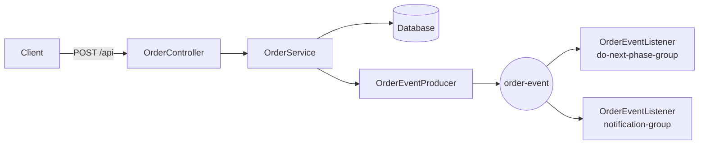

# Order Event Tracker

Spring Boot application demonstrating event-driven order lifecycle using Kafka and relational database.

What it is
- Small Spring Boot app that persists orders and advances their lifecycle by publishing/consuming `OrderEvent` messages on Kafka.

Requirements
- Java 21, Maven (or `./mvnw`), Docker (for Kafka) and a database (MySQL or H2).

Quick start

1) Start Kafka (from project root):

```bash
docker-compose up -d
```

2) Verify `src/main/resources/application.properties` has correct settings. Pre-configured with:

```properties
spring.kafka.bootstrap-servers=localhost:9092
spring.datasource.url=jdbc:mysql://localhost:3306/eventtrackerapp
spring.datasource.username=root
spring.datasource.password=ankit@123
```

Update password or database settings if needed.

3) Build & run:

```bash
./mvnw clean package
./mvnw spring-boot:run
```

API
- GET  /api                — list products
- POST /api?itemId=<id>   — place order (valid ids: 1..12)

Examples

```bash
curl http://localhost:8080/api
curl -X POST "http://localhost:8080/api?itemId=1"
```

Architecture



Config tips
- Kafka bootstrap server is set to `localhost:9092` (ensure Docker Kafka is running).
- Database credentials are pre-configured; update password in properties if using different credentials.
- For quick testing without MySQL, use H2 in-memory DB: `spring.datasource.url=jdbc:h2:mem:testdb`.

