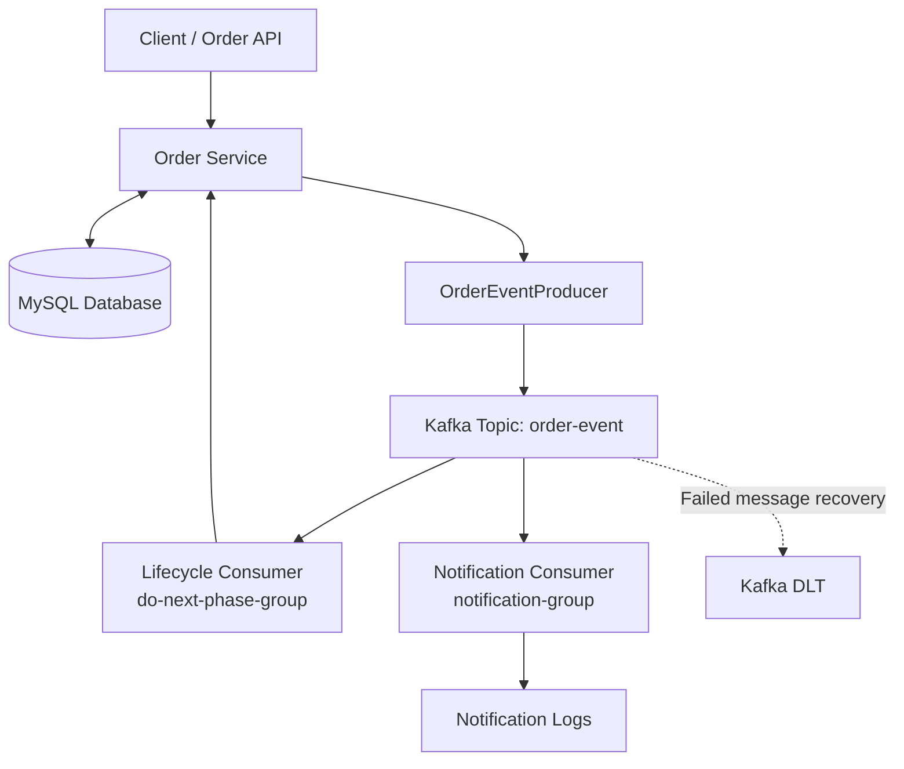

# Order Event Tracker

An event-driven order processing application built with **Java, Spring Boot, Apache Kafka, and MySQL**. The project explores asynchronous communication by processing order lifecycle events through independent Kafka consumer groups.

## Overview

The application simulates an order delivery workflow, where each status transition generates an event that triggers the next stage of processing. A separate consumer group independently processes the same events to generate notification logs.

## Features

* **Event-driven order lifecycle:** Processes transitions from `PLACED` to `DELIVERED`, including `CONFIRMED`, `SHIPPED`, and `OUT_FOR_DELIVERY`.
* **Kafka producer and consumers:** Publishes and consumes `OrderEvent` messages using Spring Kafka.
* **Independent consumer groups:** Separates order lifecycle processing from notification handling.
* **Database persistence:** Stores orders and updates their statuses using MySQL and Spring Data JPA.
* **JSON event messaging:** Serializes and deserializes event objects.
* **Failure handling:** Configures retry handling and dead-letter publishing using `DefaultErrorHandler` and `DeadLetterPublishingRecoverer`.


## Architecture



### Order Event Flow


The lifecycle consumer advances the order through its delivery stages, while the notification consumer independently processes events from the same topic. Failed-message handling is configured separately through retries and dead-letter publishing.

The order progresses through the following lifecycle:

`PLACED → CONFIRMED → SHIPPED → OUT_FOR_DELIVERY → DELIVERED`

1. The application creates an order and publishes an event to Kafka.
2. The lifecycle consumer processes the event and invokes the corresponding service method.
3. The service updates the order status in MySQL and publishes the next event.
4. The notification consumer independently reads the event and logs a status-specific message.
5. Failed message processing can trigger configured retries and dead-letter publishing.

## Tech Stack

| Technology      | Purpose                           |
| --------------- | --------------------------------- |
| Java 21         | Application development           |
| Spring Boot     | Backend framework                 |
| Spring Kafka    | Producer and consumer integration |
| Apache Kafka    | Event streaming                   |
| MySQL           | Relational persistence            |
| Spring Data JPA | Database access                   |
| Maven           | Build management                  |
| Docker Compose  | Local infrastructure              |

## API

| Method | Endpoint        | Description                 |
| ------ | --------------- | --------------------------- |
| `GET`  | `/api`          | Retrieve available products |
| `POST` | `/api?itemId=1` | Place an order for an item  |

## Limitations

* **Duplicate processing:** The application does not provide atomic database updates and Kafka event publishing, so duplicate processing and inconsistent state are possible during failures.
* **Basic recovery:** Retries and DLT publishing are configured, but automated replay and a complete recovery workflow are not implemented.
* **Console-based notifications:** Notification messages are logged rather than delivered through an external notification service.
* **Simplified workflow:** The application is a learning project, not a production-ready order management system.

## Key Learnings

* Implementing event-driven communication with Spring Kafka.
* Understanding topics, message keys, consumer groups, and offsets.
* Separating business processing from notification handling.
* Integrating Kafka consumers with database persistence.
* Exploring retry policies, dead-letter topics, and duplicate-processing concerns.

## Getting Started

**Prerequisites:** Java 21, Docker Compose, and MySQL.

```bash
git clone https://github.com/ankitkumar910/order-event-tracker.git
cd order-event-tracker
docker compose up -d
./mvnw spring-boot:run
```

Configure the MySQL database connection and ensure Kafka is accessible at `localhost:9092` before starting the application. On Windows, use `mvnw.cmd spring-boot:run`.

## Author

**Ankit Kumar** · [GitHub](https://github.com/ankitkumar910)
