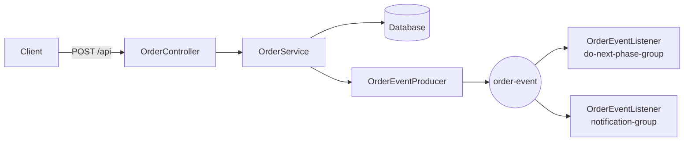

# Order Event Tracker

Minimal notes to run and understand the project.

What it is
- Small Spring Boot app that persists orders and advances their lifecycle by publishing/consuming `OrderEvent` messages on Kafka.

Requirements
- Java 21, Maven (or `./mvnw`), Docker (for Kafka) and a database (MySQL or H2).

Quick start

1) Start Kafka (from project root):

```bash
docker-compose up -d
```

2) Configure `src/main/resources/application.properties` (DB and Kafka). Ensure at least:

```properties
spring.kafka.bootstrap-servers=localhost:9092
spring.datasource.url=jdbc:mysql://localhost:3306/eventtrackerapp
spring.datasource.username=root
spring.datasource.password=<your-db-password>
```

3) Build & run:

```bash
./mvnw clean package
./mvnw spring-boot:run
```

API
- GET  /api                — list products
- POST /api?itemId=<id>   — place order (valid ids: 1..12)

Examples

```bash
curl http://localhost:8080/api
curl -X POST "http://localhost:8080/api?itemId=1"
```

Architecture



Config tips
- Set `spring.kafka.bootstrap-servers` to your Kafka address.
- For quick testing use H2 (`jdbc:h2:mem:testdb`) and `spring.jpa.hibernate.ddl-auto=update`.

If you want the README even shorter or prefer I add a MySQL service to `docker-compose.yaml`, tell me which option you prefer.

